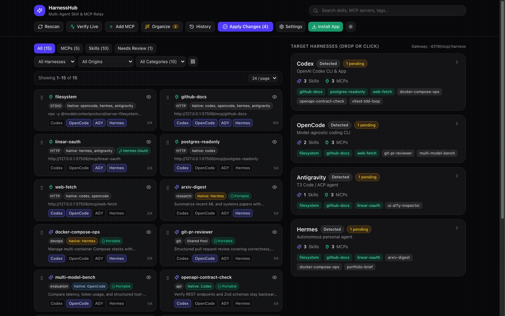
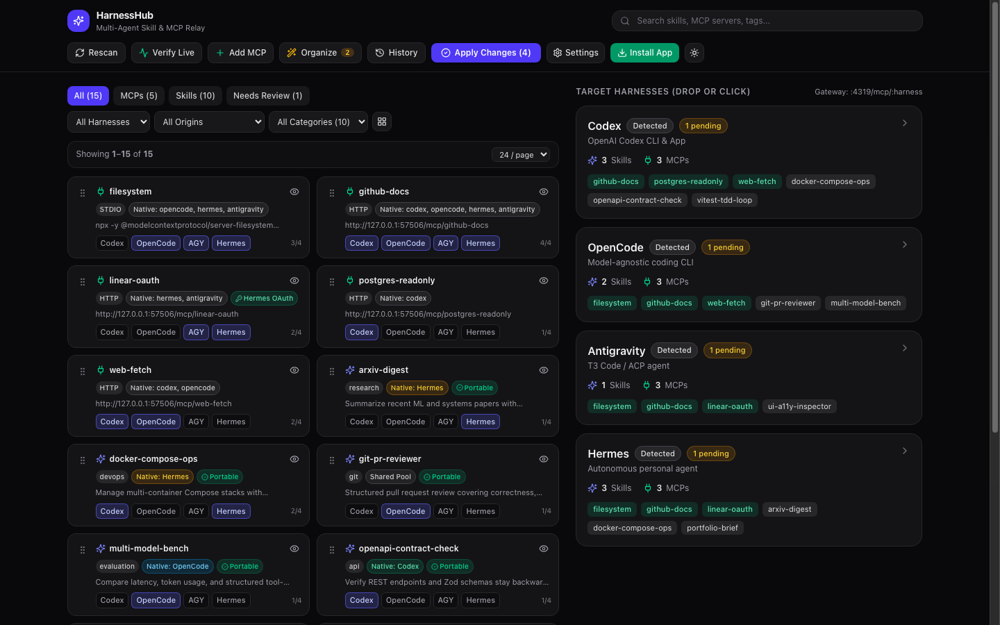
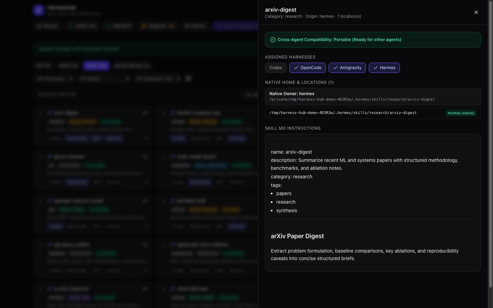
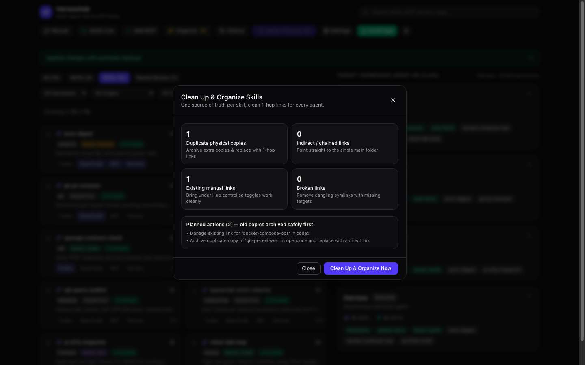
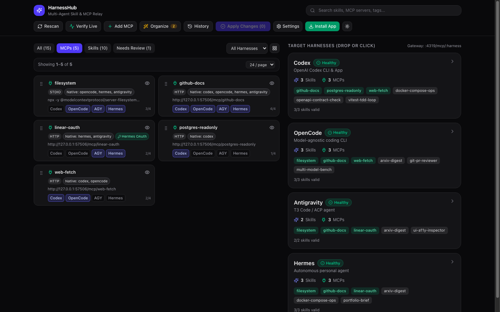
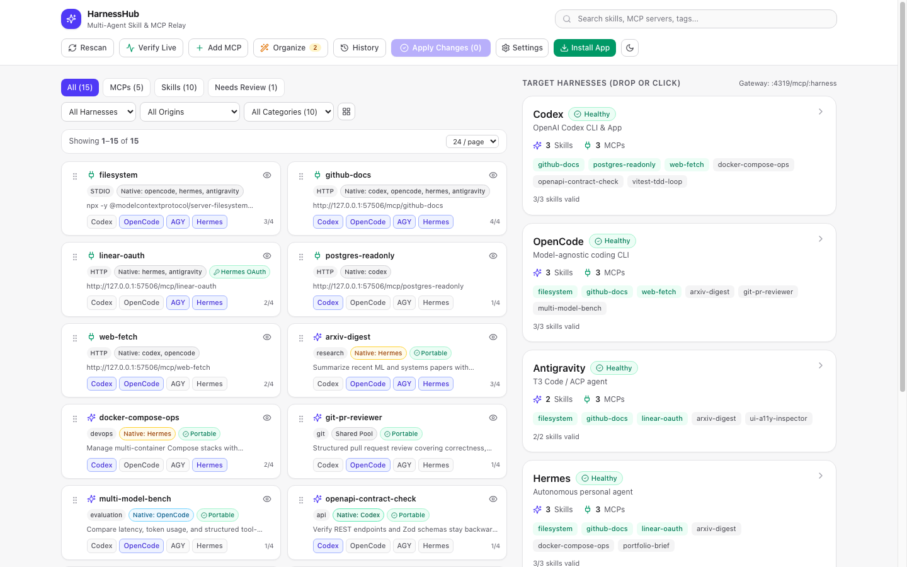

# HarnessHub

[](https://m8ven.ai/mcp/markyu0401-harness-hub-kjmhzz?s=readme)

> **The visual control plane for your AI coding agents' Skills, MCP servers, and Rules.**  
> Stop hunting through `~/.codex`, `~/.config/opencode`, `~/.hermes`, `~/.claude`, and `~/.gemini` to maintain fragile symlinks and duplicate configs. Manage once, assign with a click or drag-and-drop, and verify live readiness across every agent harness.

[简体中文](README.zh-CN.md) · [Setup Guide](docs/SETUP.md) · [PRD](docs/PRD.md) · [Architecture](docs/ARCHITECTURE.md) · [Roadmap](docs/ROADMAP.md) · [ADR-001](docs/adr/001-dual-channel-skill-distribution-and-mcp-compatibility.md) · [Changelog](CHANGELOG.md)

<p align="center">
  
</p>

---

## Why HarnessHub?

Modern AI engineers rarely stick to a single coding agent. You might use **Hermes** for daily autonomous workflows, **Codex** for deep coding, **OpenCode** for model-agnostic runs, and **Antigravity** inside **T3 Code**.

While model APIs already have unified routers (LiteLLM, OpenRouter, etc.), **your Skills (`SKILL.md`), MCP tools, CLI guides, and Rules are still fragmented per harness**:

- Every harness stores skills and MCP configs in a different directory and format (`.toml`, `.json`, `.yaml`, nested categories, or symlinks).
- Adding a new harness means manually re-wiring everything from scratch — with zero guarantee it actually loaded correctly.
- Existing MCP gateways route MCP servers, but their beta `Skills over MCP` extension (`MCP 2026-07-28` `skills/list`) is **not yet supported** by current local builds of Codex, OpenCode, Hermes, or Antigravity.
- Desktop config tools don't fit **headless server setups** (e.g., running agents on a Mac mini or Linux server while operating from a laptop browser).

**HarnessHub solves this with one self-hosted Web UI and zero manual file-hunting.**

---

## Screenshots

| Allocation Matrix & Native Origin Badges | Skill Inspector & Portability Lint |
| :---: | :---: |
|  |  |

| One-Click Skill Library Organizer | MCP Gateway & Live Verification |
| :---: | :---: |
|  |  |

Also includes a full Light Theme and installable standalone Desktop App (PWA) mode:

<p align="center">
  
</p>

---

## Core Experience

- **Visual Allocation Matrix (Click or Drag & Drop)**  
  - **Skill / MCP View**: View every discovered `SKILL.md` (auto-deduplicated by SHA-256 with native owner badges such as `Native: Hermes`, `Native: Codex`, `Shared Pool`) and MCP server, with instant toggles and drag targets for `Codex`, `OpenCode`, `Antigravity`, and `Hermes`.
  - **Harness View**: Click any harness card to inspect everything currently assigned to it, toggle tools, or drag capabilities in and out.
- **One-Click Skill Library Organizer**  
  Safely consolidate duplicate physical skill copies into `~/.agents/skills`, flatten multi-hop symlinks to clean 1-hop links, preserve nested Hermes category directories, and keep an undo archive.
- **Zero Plumbing Exposed**  
  Users never pick between "symlinks vs. MCP extensions" — HarnessHub automatically handles native directory adapters + standard MCP fallback (`tools/call`) + timestamped rollback snapshots before every write.
- **Built-in Streamable HTTP MCP Gateway & Shared OAuth Reuse**  
  Route `stdio` / `http` / `sse` MCP servers through `/mcp/{codex,opencode,antigravity,hermes}` with per-harness tool filtering (`disabledTools`), runtime `${ENV}` / `op://` secret injection, and Hermes default OAuth token reuse.
- **Real Headless Smoke Verification**  
  One-click **Verify Live** runs config parse checks, symlink integrity checks, HTTP/Gateway MCP tool-count probes, and `codex app-server` readiness checks.

---

## Harness Compatibility Matrix

| Harness | Config / Skill Format | Standard MCP Gateway | Native `SKILL.md` Sync | `MCP 2026-07-28` `skills/list` |
| :--- | :--- | :---: | :---: | :---: |
| **Codex** | `~/.codex/config.toml`, `~/.codex/skills` | ✅ Supported | ✅ Supported | ❌ Not yet |
| **OpenCode** | `~/.config/opencode/opencode.json`, `skills/` | ✅ Supported | ✅ Supported | ❌ Not yet |
| **Hermes** | `~/.hermes/config.yaml`, `~/.hermes/skills` | ✅ Supported | ✅ Supported | ❌ Not yet |
| **Antigravity** | `mcp_config.json`, `config/skills` | ✅ Supported | ✅ Supported | ❌ Not yet |
| **Claude Code** *(M4)* | `~/.claude/`, `~/.claude/skills` | Planned | Planned | ⚠️ Client-dependent |

See [ADR-001](docs/adr/001-dual-channel-skill-distribution-and-mcp-compatibility.md) for the technical audit behind this matrix.

---

## Quick Start

### Try the Isolated English Demo Sandbox (Zero Risk)

Test the entire UI and workflow inside a temporary directory without touching your real agent configs:

```bash
pnpm install
pnpm build
pnpm demo
```

Open **`http://127.0.0.1:4319/`** in your browser. Press `Ctrl+C` when finished to delete the temporary sandbox.

### Install on Your Machine

```bash
pnpm install
pnpm test
pnpm build

# Interactive setup wizard (choose 127.0.0.1 local-only or 0.0.0.0 LAN/Tailscale + passcode + auto-start)
node apps/server/dist/cli.js setup

# Or install the persistent background service directly (defaults to 127.0.0.1:4310)
node apps/server/dist/cli.js service install
```

Open `http://127.0.0.1:4310/` (or your Tailscale/LAN URL when remote access is enabled) and click **Install App** (or Chrome's **Install page as app**) to launch HarnessHub as a standalone desktop app.

For detailed service commands, environment variables, and gateway usage, read the full **[Setup Guide](docs/SETUP.md)**.

---

## Architecture & Tech Stack

- **Monorepo**: `pnpm` workspaces + TypeScript (`packages/core`, `packages/skills-mcp`, `apps/server`, `apps/web`)
- **Web UI**: React + Vite + Tailwind CSS + `@dnd-kit` + PWA (`manifest.webmanifest` + Service Worker)
- **Control Plane & Gateway**: Node.js + Fastify + `@modelcontextprotocol/sdk`
- **State Store**: Canonical YAML registry (`~/.harness-hub/registry.yaml`), `settings.json`, and timestamped rollback snapshots (`~/.harness-hub/backups/`)

---

## Project Status

**M0–M3 + M4.1–M4.2 complete** (Core discovery & adapters, Allocation Matrix Web UI, MCP Gateway & Live Verifier, `launchd`/`systemd` daemonization, and Skill Library Organizer).  
Remaining for `v0.1.0`: `Claude Code` & `Cursor` adapters ([#6](https://github.com/markyu0401/harness-hub/issues/6)). See [docs/ROADMAP.md](docs/ROADMAP.md).

---

## Contributing

Contributions, adapter plugins for additional harnesses, and UX feedback are welcome! Please read [CONTRIBUTING.md](CONTRIBUTING.md) and [AGENTS.md](AGENTS.md) before opening a PR.

## License

[MIT](LICENSE) © 2026 markyu0401
